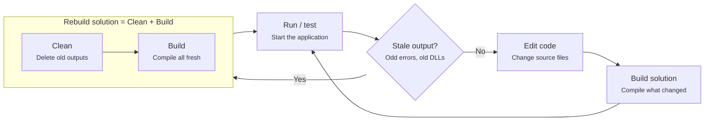

# Build vs Clean vs Rebuild Solution

A quick guide for Visual Studio users.

In Visual Studio, **Build**, **Clean** and **Rebuild** turn your source code into a runnable application. This guide explains what each command does, how they relate, and when to use them.

## What each command does

| Command | Purpose | What it does to your files |
|---|---|---|
| Build Solution | Compile only what is needed | Compiles projects that changed since the last build (incremental build) and skips the rest. |
| Clean Solution | Remove old build output | Deletes compiled files from `bin` and `obj`. It compiles nothing. |
| Rebuild Solution | Start from scratch | Runs Clean, then Build on every project. |

## Workflow diagram

Normal flow is edit, Build, then run. If the output looks stale or the errors make no sense, use Rebuild, which is Clean followed by a full Build.

## Example

Suppose your solution has three projects: `App.Web`, `App.Business` and `App.Data`.

1. **First build:** all three projects compile.
2. You edit one file in `App.Business`. Build Solution recompiles `App.Business` and anything that depends on it, and skips `App.Data`. This is fast and is what you use most of the time.
3. You switch Git branches, update a NuGet package, or see errors that don't match your code. The `bin` and `obj` folders may hold stale files, so you run Rebuild Solution. It deletes everything and compiles all three projects from scratch.

## Order of use in real projects

1. **Day to day:** edit code, Build (`Ctrl+Shift+B`), then run or test. Use this almost every time.
2. **When something looks wrong** (stale DLLs, nonsensical errors, changes that don't show up): Rebuild Solution.
3. **If Rebuild doesn't fix it:** Clean Solution, close Visual Studio, delete the `bin` and `obj` folders manually, reopen and Build.
4. **Before a release or deployment:** Clean, then Build in Release configuration (or Rebuild). This guarantees no leftover debug files. CI/CD pipelines typically do a clean build on every run.

## Key takeaways

- Clean followed by Build gives the same result as Rebuild.
- Clean on its own is mostly useful when you want to clear output without compiling, such as before zipping the project or committing a clean folder.
- Prefer Build for speed; reach for Rebuild only when you suspect stale output.